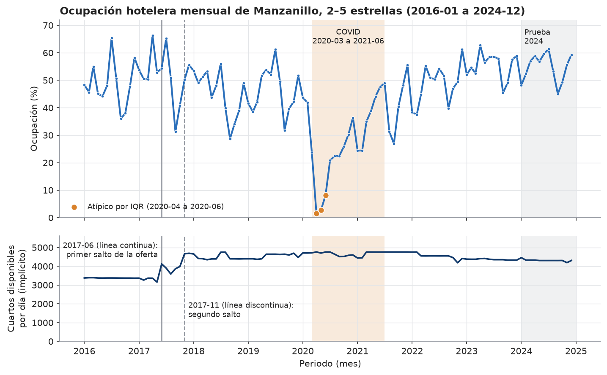
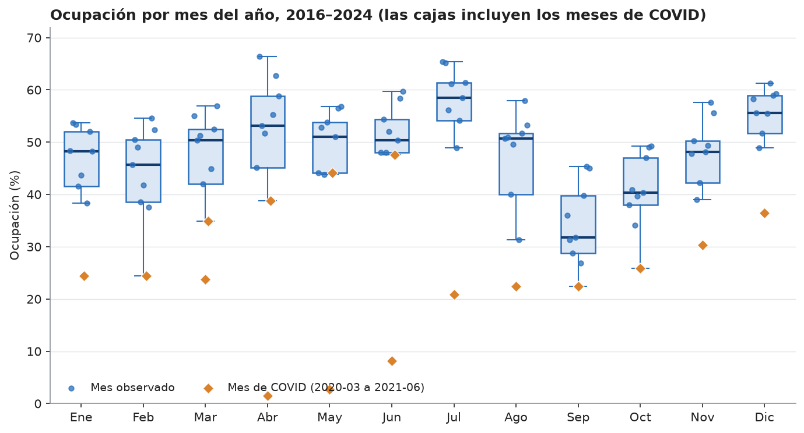
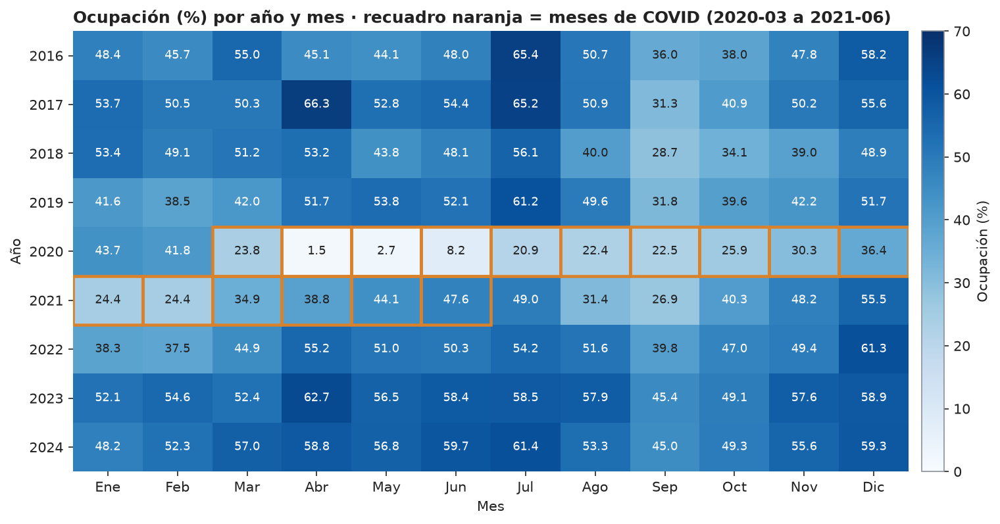
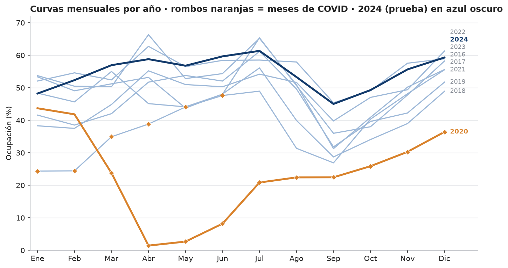

# Exploración estadística de la ocupación hotelera de Manzanillo (E1)

Rama `e1/leslie-l2` · 2026-11-13 · Responsable: Leslie Valadez Macías (integrante A).
Código: [`laboratorio/exploracion/explorar.py`](../../laboratorio/exploracion/explorar.py) · Resultados: [`laboratorio/exploracion/resultados/`](../../laboratorio/exploracion/resultados/) · Pruebas: [`tests/test_exploracion.py`](../../tests/test_exploracion.py).
Reproducir: `python -m laboratorio.exploracion.explorar` (requiere `requirements-lab.txt`).

## 0. Alcance y límites
- **Fuente única:** la capa oro `data/oro/manzanillo_ocupacion_mensual.csv`, leída con `pipeline.interfaz.cargar_oro_mensual` (que la valida); la serie es la ocupación de las categorías de 2 a 5 estrellas (cociente de sumas, contrato 1.0.0), 108 meses de 2016-01 a 2024-12.
- **Es descriptiva.** No ajusta modelos y **no explica causas**: cuando algo coincide en el tiempo con otro hecho, se dice «coincide», no «se debe a». Las pruebas de estacionariedad, ACF/PACF, la correlación cruzada y los pronósticos son del laboratorio de la integrante B ([`pronostico.md`](pronostico.md), `laboratorio/pronosticos/`) y **no se repiten aquí**.
- Las gráficas usan los 108 meses (también 2024, año de prueba, que se marca en gris); las cifras son descriptivas y **no se usaron para elegir parámetros**. Los parámetros de transformación se ajustan solo con 2016–2023 ([`transformaciones.md`](transformaciones.md)).
- **Los meses de COVID (2020-03 a 2021-06, 16 meses) y los atípicos se conservan** y se marcan en naranja (decisión del contrato: son eventos reales, no errores).
- Los PNG se generan sin marcas de tiempo; la misma versión de matplotlib produce los mismos bytes (probado en dos corridas). Con otra versión o sistema pueden variar pixeles; las cifras (CSV y JSON) no.

## 1. Estadísticas descriptivas ([`estadisticas_descriptivas.csv`](../../laboratorio/exploracion/resultados/estadisticas_descriptivas.csv))
La «Desv. est.» de esta sección es la desviación estándar **muestral** (`ddof=1`). El z-score de [`transformaciones.md`](transformaciones.md) usa la **poblacional** (`ddof=0`): en el entrenamiento, 12.7659 frente a 12.83 aquí.
| Grupo | n | Media | Desv. est. | Mín. | Mediana | Máx. | Asimetría |
|---|---|---|---|---|---|---|---|
| Todo (2016–2024) | 108 | 45.86 | 12.60 | 1.46 | 49.01 | 66.34 | −1.24 |
| Entrenamiento (2016–2023) | 96 | 44.75 | 12.83 | 1.46 | 48.11 | 66.34 | −1.13 |
| Prueba (2024) | 12 | 54.73 | 5.13 | 45.02 | 56.22 | 61.35 | −0.62 |
| Sin los meses de COVID | 92 | 49.39 | 8.49 | 26.91 | 50.40 | 66.34 | −0.48 |
| Meses de COVID | 16 | 25.55 | 13.39 | 1.46 | 24.41 | 47.62 | −0.31 |

Lectura: la serie es asimétrica a la izquierda por los meses de COVID (la asimetría pasa de −1.24 a −0.48 sin ellos). El año de prueba tiene **menos variación** (desviación muestral 5.13 frente a 12.60 del total y 8.62 del entrenamiento sin COVID) y una media 10 puntos porcentuales mayor que la del entrenamiento. Es una característica de los datos que conviene tener presente al interpretar el error de 2024; no es un juicio sobre ningún modelo. Tablas por año ([`estadisticas_por_anio.csv`](../../laboratorio/exploracion/resultados/estadisticas_por_anio.csv)) y por mes ([`estadisticas_por_mes.csv`](../../laboratorio/exploracion/resultados/estadisticas_por_mes.csv)).

## 2. Gráfica 1 · Serie temporal mensual

**Qué se ve.** Arriba, la ocupación mensual; abajo, la oferta diaria implícita (`cuartos_disponibles` ÷ días del mes). Banda naranja: COVID. Banda gris: 2024. Líneas verticales: 2017-06 (continua) y 2017-11 (discontinua).
- **Rango:** máximo 66.34 % (2017-04) y mínimo 1.46 % (2020-04); media 45.86 %.
- **COVID:** durante los 16 meses marcados la media fue 25.55 %, frente a 49.39 % en el resto. Los tres atípicos por IQR (2020-04, 2020-05 y 2020-06, con 1.46 %, 2.69 % y 8.19 %) son parte de ese periodo. Después de 2021-06 la recuperación es irregular: 49.0 % en 2021-07, 26.9 % en 2021-09 y 55.5 % en 2021-12; en 2023 y en 2024 todos los meses superan 45 % (mínimos de 45.4 % y 45.0 %).
- **Quiebres de 2017 (en la oferta, no en la ocupación):** la oferta diaria implícita pasa de 3,158 (2017-05) a 4,122 cuartos (2017-06), +30.5 %, y de 3,985 (2017-10) a 4,662 (2017-11), +17.0 %. Desde 2017-11 va de 4,186 (2022-11) a 4,761 (2020-04) cuartos. En cambio, la ocupación, que es un cociente, **no muestra un cambio de nivel** en esas fechas (media 2017-06 a 2017-10: 48.5 % frente a 47.6 % en los mismos meses de 2016; 2017-11 a 2018-03: 51.9 % frente a 52.1 % en el mismo periodo anterior).

**Qué no se puede concluir.** El reporte no indica por qué subió la oferta medida; el salto puede ser un cambio de marco de los datos o crecimiento real, y con estos datos no se distingue (contrato §1.1 lo trata como cambio de marco, con la columna `d_oferta_2017`). Tampoco se atribuye la caída de 2020 a una causa; solo coincide con el periodo marcado como COVID.

## 3. Gráfica 2 · Boxplot por mes del año

**Qué se ve.** Cada caja resume 9 observaciones (un mes por cada año de 2016 a 2024); los puntos son los años y los rombos naranjas los meses de COVID. Las cajas **incluyen** los meses de COVID.
- **Patrón por mes (medias sin COVID):** julio es el más alto (58.9 %), seguido de diciembre (56.2 %) y abril (56.2 %); septiembre es el más bajo (35.6 %), y octubre le sigue (42.3 %). La diferencia entre julio y septiembre es de 23.2 puntos porcentuales. Con los meses de COVID incluidos el orden se mantiene en los extremos (julio 54.6 %, septiembre 34.2 %).
- **Septiembre** es el mes más bajo en 6 de los 9 años; en 2020 y 2021 el más bajo es un mes de COVID (abril de 2020 y enero de 2021) y en 2022 es febrero (37.5 %, con septiembre en 39.8 %).
- **Dispersión:** abril y mayo son los meses con más dispersión (desviaciones de 19.4 y 16.7) **solo por el COVID** (1.46 % y 2.69 % en 2020). Sin COVID, abril va de 45.1 % (2016) a 66.3 % (2017).

**Qué no se puede concluir.** Con 7 a 9 observaciones por mes, las cajas son una descripción, no una prueba de estacionalidad. Esa evaluación formal (descomposición, ACF/PACF, modelos estacionales) no se hace aquí. No se explica el patrón (por ejemplo, el comportamiento de abril entre años queda sin interpretar).

## 4. Gráfica 3 · Mapa de calor año × mes

**Qué se ve.** Cada celda es un mes; más oscuro = mayor ocupación. El recuadro naranja marca los 16 meses de COVID.
- **Fila 2020 y primeros meses de 2021:** concentran los valores más bajos (de 1.5 % en abril de 2020 a 36.4 % en diciembre de 2020; enero y febrero de 2021 con 24.4 %).
- **Valores más altos:** abril y julio de 2017 (66.3 % y 65.2 %), julio de 2016 (65.4 %) y abril de 2023 (62.7 %).
- **Columna de septiembre:** en los meses sin marca de COVID es de los valores más bajos de cada fila (de 26.9 % en 2021 y 28.7 % en 2018 a 45.4 % en 2023).
- **Años:** el año con media más alta es 2023 (55.3 %) y el más bajo 2020 (23.3 %); 2017 tiene la mayor media antes de 2023 (51.9 %). Las filas de 2023 y 2024 son más homogéneas (desviación de 4.9 y 5.1) que las de 2016 a 2019 (de 8.2 a 9.4).

**Qué no se puede concluir.** La mayor homogeneidad de 2023–2024 es un hecho de estos 24 meses; no permite asegurar que la estacionalidad se haya atenuado de forma permanente.

## 5. Gráfica 4 · Curvas mensuales comparadas por año

**Qué se ve.** Una curva por año sobre los meses de enero a diciembre; 2020 resaltado en naranja, 2024 (año de prueba) en azul oscuro y los rombos naranjas marcan los meses de COVID de cualquier año (también enero a junio de 2021).
- Las curvas de los años sin COVID comparten una **forma parecida**: un valle en septiembre, y un repunte hacia diciembre. 2020 se separa desde marzo y no vuelve a la zona de los demás años dentro del año.
- La curva de 2024 queda por encima de los valores de 2016–2019 en 9 de los 12 meses y por encima del mínimo de esos años en los 12; su recorrido es cercano al de 2023 (media 54.7 % frente a 55.3 %).

**Qué no se puede concluir.** Que 2024 se parezca a 2023 no demuestra que se repetirá en 2025; la validación de pronósticos está en el laboratorio de la integrante B.

## 6. Limitaciones de esta exploración
- Una sola serie de un solo destino y categorías 2 a 5 estrellas; sin intervalos de confianza para las tablas descriptivas.
- La **descomposición** (clásica y STL robusta, con su figura) y la **correlación cruzada** con una segunda variable **ya existen** en el laboratorio de la integrante B ([`pronostico.md`](pronostico.md) §2.5 y §2.6, `laboratorio/pronosticos/resultados/descomposicion_oro.png`); junto con la estacionariedad y la ACF/PACF. No se duplicaron aquí.
- Las figuras no sustituyen una prueba estadística; son descriptivas y están pensadas para el informe y la presentación.
