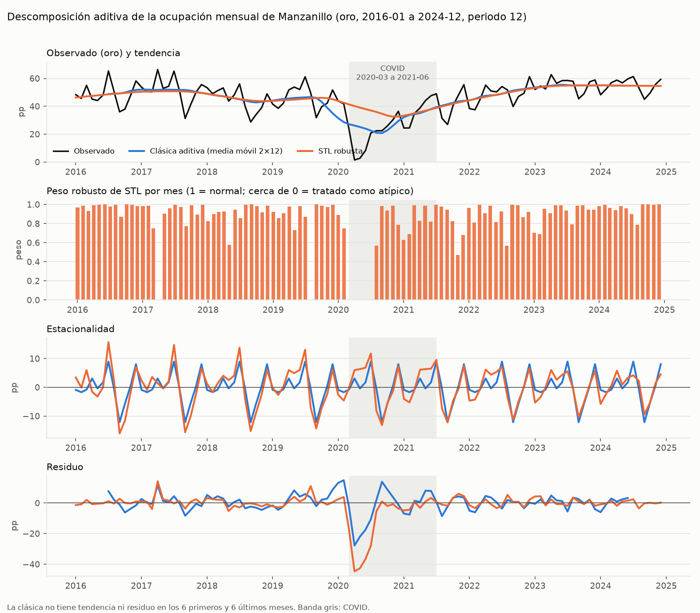

# Pronóstico de la ocupación hotelera de Manzanillo · E1

Responsable: Eimy Melissa Urbina Meza (integrante B) · Rama `e1/eimy-pronosticos` · Contrato de datos 1.0.0.
Estado: **evaluación definitiva con la capa oro** (`data/oro/manzanillo_ocupacion_mensual.csv`, integrada en `main` por el PR #8), con la revisión recíproca de la integrante A en [`auditorias.md`](../../calidad/auditorias.md). El oro se validó contra la derivación de referencia del contrato §7 antes de evaluar (§7).
Código y comandos: [`laboratorio/pronosticos/`](../../laboratorio/pronosticos/README.md). Todas las cifras de este documento salen de `laboratorio/pronosticos/resultados/`, ejecución `python -m laboratorio.pronosticos.ejecutar --fuente oro` del 2026-11-13 07:18 UTC (29.4 s; `ejecucion.json`: `fuente = "oro"`, SHA-256 del oro `135a056f…`).

> **Aviso de interpretación.** Los valores de 2024 que aparecen como "pronóstico" son una **proyección retrospectiva**: modelos entrenados solo con 2016–2023 y comparados contra el dato observado de 2024. Los valores de 2025 son una **proyección futura**: no existe dato observado en la base usada (Base70 termina en 2024-12). Ninguna predicción se presenta como dato.

## 1. Validación del contrato (D1, D2, D3, D7)
Se recalcularon las cifras del contrato con `data/bronce/datatur/Base70centros.csv` (SHA-256 `a8ca3f9b…d671`).

| Decisión | Verificación | Resultado |
|---|---|---|
| D1 · 2 a 5 estrellas, cociente de sumas | 453 filas de Manzanillo; 0 duplicados `(periodo, categoria)`; los 108 meses tienen las 4 categorías. Serie: mín. 1.46 (2020-04), máx. 66.34 (2017-04), media 45.86. Promedio simple frente a ponderado: hasta 12.82 pp, 90 meses > 0.5 pp. Efecto de incluir 1 estrella: hasta 2.26 pp, media −1.47 pp en 21 meses | **Conforme** |
| D2 · 96 + 12 meses | 2016-01..2023-12 = 96; 2024-01..2024-12 = 12 | **Conforme** |
| D3 · conservar 2017 y COVID | COVID (2020-03..2021-06): media 25.55 % frente a 49.39 % en el resto. Atípicos IQR: 2020-04, 2020-05, 2020-06 | **Conforme**, con la observación 2 |
| D7 · variables exploratorias | Rangos y correlaciones de §4.1 reproducidos (0.216 / 0.006 sin COVID; 0.161; 0.558 / 0.355; rezago 1: 0.203, 0.043, 0.321; componente residente 0.994) | **Conforme**, con la observación 3 |

**Observaciones (no son errores de las decisiones; se reportan a la integrante A antes de cualquier cambio al contrato):**
1. **Cifras de §1.1 calculadas con todas las categorías, no con la variable objetivo.** "+29.6 % en 2017-06", "≈ 3,551 cuartos al día en 2016-01" y "49.1 % en el resto" corresponden a las 5 categorías (incluida 1 estrella). Con 2 a 5 estrellas son **+30.5 %**, **3,373 cuartos/día** y **49.39 %**. El +17.0 % de 2017-11 coincide en ambas definiciones. Propuesta: aclarar en §1.1 a qué definición corresponde cada cifra.
2. **El segundo salto de oferta (2017-11, +17.0 %) no tiene indicador.** `d_oferta_2017` solo marca 2017-06. La ocupación es un cociente y no muestra un quiebre de nivel visible en esas fechas, así que no afecta a los modelos de este laboratorio; se deja anotado por si E2/E3 usan la oferta absoluta.
3. **Las correlaciones de §4.1 usan la serie completa (incluye 2024).** Son válidas como descripción, pero no para elegir regresores. Por eso la correlación cruzada de este laboratorio se recalcula **solo con el entrenamiento** (§2.5).

## 2. Análisis estadístico (solo entrenamiento, 2016-01 a 2023-12)
### 2.1 Caracterización
96 meses; media 44.75 %, con 2020 (23.3 %) y 2021 (38.8 %) muy por debajo del resto de los años (45.5 % a 55.3 %). Excluyendo COVID, el perfil mensual tiene **picos en julio (58.5 %), diciembre y abril (≈ 55.7 %)** y un **valle en septiembre (34.3 %)**. 2023 es el año más alto del entrenamiento (55.3 %), así que el final del entrenamiento es una recuperación.

### 2.2 Descomposición (`estadistica.descomponer`)
Descomposición clásica con periodo 12, aditiva y multiplicativa. Criterio explícito: (1) si el error de reconstrucción difiere ≥ 5 %, gana el menor; si no, (2) decide la correlación entre el nivel anual y la amplitud estacional (≥ 0.5 indica multiplicativa).
Resultado: errores equivalentes (6.58 frente a 6.55 pp, 0.5 % de diferencia); correlación amplitud–nivel **−0.47**, de modo que la amplitud **no** crece con el nivel → **aditiva**. Fuerza de la tendencia 0.70 y de la estacionalidad 0.42 (aditiva). Limitación: con 6 años completos esa correlación está dominada por 2020 (nivel bajo y caída extrema), así que es evidencia débil. La gráfica de la descomposición de los 108 meses del oro y sus limitaciones están en §2.6.

### 2.3 Estacionariedad (ADF + KPSS, `estacionariedad_adf_kpss.csv`)
| Transformación | ADF p | KPSS p | Lectura |
|---|---|---|---|
| Niveles (constante + tendencia) | 0.531 | ≤ 0.01 | No estacionaria |
| d = 1 | 0.052 | ≥ 0.10 | Frontera: ADF no rechaza al 5 % |
| D = 1 | 0.451 | ≥ 0.10 | ADF no rechaza (persistencia del choque COVID) |
| **d = 1 y D = 1** | **0.0005** | ≥ 0.10 | **Estacionaria por ambas pruebas** |

Regla (`elegir_diferenciacion`): la menor diferenciación con ADF que rechaza y KPSS que no rechaza al 5 % → **d = 1, D = 1**. KPSS reporta p acotado a su tabla [0.01, 0.10].

### 2.4 ACF y PACF (serie con d = 1, D = 1; `acf_pacf_d1_D1.csv`, figura `identificacion_sarima_d1_D1.png`)
Banda ±0.215. Significativos: **rezago 12** (ACF −0.47, PACF −0.39), rezago 11 (−0.28 / −0.24) y rezago 5 (−0.23 / −0.22). El pico negativo aislado en 12 en la ACF, con PACF que decae, sugiere un **MA(1) estacional (Q = 1)**; en los rezagos bajos no hay cortes claros, por lo que se buscan p, q ≤ 2 y P ≤ 1. Esa lectura fija los límites de la búsqueda por AICc (§3).

### 2.5 Correlación cruzada (`correlacion_cruzada.csv`)
corr(y_t, x_{t−k}), k = 0..12, entre las series con d = 1, D = 1, **solo con el entrenamiento**; también con los pares que tocan COVID excluidos. k = 0 se calcula pero se marca **no utilizable** (la variable se publica con el objetivo; contrato §4.1).
- `pct_cuartos_no_residentes`: rezagos útiles significativos aislados (k = 9 con todo; k = 1, r = 0.30, solo sin COVID).
- `estadia_promedio`: k = 2 (r = −0.33) y k = 4 (0.25) con todo; **ninguno sin COVID**.
- `densidad_ocupacion`: contemporánea 0.47 (dependencia mecánica, §4.1); con rezago, k = 11 y 12 negativos, que no se mantienen sin COVID.
Con 36 pruebas por escenario se esperan ≈ 2 falsos positivos al 5 %; ningún rezago es significativo en ambos escenarios. **Conclusión: no se incorporan exógenas.** La única exógena usada es `d_covid`, de calendario y conocida de antemano (0 en 2024 y 2025).

### 2.6 Gráfica de la descomposición del oro (`descomposicion_oro.png`, `descomposicion_componentes.csv`)

**Datos y método.** Son los 108 meses del oro (2016-01 a 2024-12), leídos con `pipeline.interfaz`. La descomposición es **aditiva** (elegida en §2.2) con **periodo 12** (ciclo anual de una serie mensual), calculada con dos métodos (`estadistica.componentes_descomposicion`):
- **Clásica** (`seasonal_decompose`). La tendencia es una media móvil centrada 2×12; la estacionalidad es el promedio por mes de la serie sin tendencia, **igual cada año**; el residuo es lo que queda. Es la misma técnica del §2.2.
- **STL robusta** (Cleveland et al., 1990; `STL(period=12, robust=True)`). Usa regresiones locales con pesos que reducen la influencia de los atípicos; la estacionalidad puede cambiar lentamente entre años.

La figura es **descriptiva** e incluye 2024. Las decisiones de modelado (aditiva; d y D) se tomaron solo con el entrenamiento (§2.2 y §2.3).

**Lectura.**
| Medida (108 meses) | Clásica | STL robusta |
|---|---|---|
| Fuerza de la tendencia / de la estacionalidad | 0.72 / 0.42 | 0.52 / 0.27 |
| Componente estacional promedio: julio, diciembre, septiembre | +8.9, +8.0, −12.1 pp | +10.6, +6.4, −13.1 pp |
| Desviación del residuo: meses de COVID / resto | 11.70 / 4.41 pp | 16.64 / 2.87 pp |
| Residuo mínimo | −27.8 pp (2020-04) | −44.7 pp (2020-04) |
| Meses sin componente | 12 (los 6 primeros y los 6 últimos) | 0 |

Ambos métodos muestran el mismo patrón estacional: picos en julio y diciembre, y un valle en septiembre, con octubre también bajo. La tendencia baja en 2018–2019, cae con COVID y se recupera hasta alrededor de 55 % en 2023–2024.

**Limitaciones, sobre todo por COVID.**
- **La clásica reparte el choque en el tiempo.** La media móvil de 13 meses "anticipa" la caída: en 2020-01 la tendencia ya es 31.5 % con un observado de 43.7 %, así que enero y febrero de 2020 quedan con residuos artificiales de +13.1 y +14.9 pp; lo mismo ocurre de forma simétrica en la recuperación (2020-09, +13.9 pp). Además, la estacionalidad clásica promedia todos los años, incluido 2020, y no tiene tendencia ni residuo en 2016-01 a 2016-06 ni en 2024-07 a 2024-12.
- **STL robusta aísla mejor el choque, pero no lo explica.** Mantiene la tendencia cerca de 43.8 % hasta el inicio de COVID y manda la caída al residuo (−44.7 pp en 2020-04). Su peso robusto queda por debajo de 0.5 en 2020-03 a 2020-07 (y en 2017-04, 2019-08 y 2021-11), es decir, trata esos meses como atípicos. Aun así, su tendencia baja suavemente durante 2020 porque ninguna descomposición separa un cambio de nivel temporal de la tendencia sin un modelo explícito. Para eso el SARIMA usa la intervención `d_covid` (§3).
- **La estacionalidad de STL varía entre años** (en 2020 se deforma junto con el choque); con 9 ciclos no se puede afirmar que el patrón estacional haya cambiado de forma permanente.
- **Es una descripción, no una prueba.** La estacionalidad se evalúa formalmente con ADF/KPSS y ACF/PACF (§2.3 y §2.4). El abril alto de 2017 (peso STL bajo) coincide con Semana Santa en abril; no hay indicador de esa fecha móvil (§5).

### 2.7 Normalización: min-max frente a z-score (`escalamiento.py`)
Comparación aplicada a dos métodos, con las funciones de `pipeline/transformaciones.py` (integrante A). **Todos los parámetros de escala se ajustan solo con el entrenamiento**; 2024 se transforma con ellos sin recalcular nada.

**Alcance: esto es una comparación metodológica de escalamiento, no un modelo de pronóstico.** El k-NN se usa **solo como instrumento para mostrar el efecto de normalizar** en un método basado en distancias; **no es el modelo operativo elegido ni un candidato para el cliente**. El modelo elegido y publicado sigue siendo SARIMA(1,1,1)(0,1,1)₁₂ + `d_covid` (§4 y §6); el k-NN **no participa** en la selección del §4 ni en el pronóstico del §6, y sus errores no deben usarse para elegir un modelo.

**Método de la comparación: k vecinos más cercanos (k-NN) para pronóstico a un paso.** Se eligió porque es un método **basado en distancias**: la escala de cada variable decide cuánto pesa en la distancia y, por lo tanto, qué meses se toman como "parecidos". En los modelos de series de tiempo del §3 la escala de la serie no cambia el resultado (ver el control abajo), así que no sirven para mostrar el efecto de normalizar.
- **Variables del mes t, todas conocidas antes de t:** ocupación en t−1 y t−12, `pct_cuartos_no_residentes`, `estadia_promedio` y `densidad_ocupacion` en t−1 (variables D7 rezagadas, como permite el contrato §4.1). El objetivo no se escala: la predicción es el promedio, en puntos porcentuales, de la ocupación de los k vecinos.
- **Filas de entrenamiento:** 2017-01 a 2023-12 (84). 2016 solo aporta los rezagos de 12 meses.
- **Elección de k sin ver 2024:** validación interna con escala y memoria ajustadas en 2017–2022 y error en 2023, con k ∈ {1, 3, 5, 7, 9} y criterio de menor RMSE. Después se reajusta la escala con 2017–2023 y se pronostica 2024 un mes a la vez (el mes t usa los datos observados hasta t−1).

**Parámetros ajustados con 2017-01 a 2023-12** (`escalamiento_parametros.json`; n = 84, `ajustado_hasta = 2023-12` en todos):
| Variable | Mín. | Máx. | Media | Desv. (`ddof=0`) |
|---|---|---|---|---|
| Ocupación t−1 | 1.4591 | 66.3399 | 44.2037 | 13.2274 |
| Ocupación t−12 | 1.4591 | 66.3399 | 43.2384 | 12.8394 |
| % cuartos no residentes t−1 | 0.3839 | 15.2944 | 5.0548 | 2.8345 |
| Estadía promedio t−1 | 1.6793 | 3.0376 | 2.1882 | 0.3843 |
| Densidad de ocupación t−1 | 1.4056 | 3.0009 | 2.6142 | 0.2455 |

Ningún valor de 2024 queda fuera del rango min-max del entrenamiento.

**Resultados** (`escalamiento_knn_2024.csv`, `escalamiento_knn_validacion_2023.csv`):
| Escala | k elegido | RMSE en validación 2023 | MAE 2024 | RMSE 2024 | MAPE 2024 | Peso de los dos rezagos de ocupación en la distancia |
|---|---|---|---|---|---|---|
| Sin escalar | 7 | 6.64 | **2.25** | **2.99** | **4.30 %** | 97.6 % |
| Min-max | 5 | 5.86 | 4.14 | 5.13 | 8.00 % | 36.6 % |
| Z-score | 5 | **5.24** | 4.10 | 4.79 | 7.73 % | 40.0 % |

El peso es la proporción de la varianza de cada variable escalada en el entrenamiento, que es lo que aporta a la distancia euclidiana.

**Lectura.**
- **Escalar cambia el método:** sin escalar, la distancia depende casi solo de la ocupación (97.6 %), porque las variables D7 miden en unidades pequeñas. Con min-max o z-score, las tres variables D7 pasan a pesar el 60–63 %. Los vecinos elegidos cambian: en 2024 solo coinciden el 37 % (min-max) y el 35 % (z-score) con los de la versión sin escalar.
- **Min-max frente a z-score:** dan resultados **parecidos entre sí** (70 % de vecinos en común; RMSE 5.13 frente a 4.79 en 2024 y 5.86 frente a 5.24 en la validación). Con 12 meses, esa diferencia de 0.3 a 0.6 pp **no permite afirmar** que una sea mejor. La diferencia de fondo es que **z-score iguala el peso** de todas las variables (20 % cada una), mientras que **min-max lo hace depender de los extremos**: el mínimo de COVID (1.46 %) comprime la ocupación habitual y le da a cada rezago de ocupación solo 18–19 % del peso, mientras que la estadía, con una distribución más extendida dentro de su rango, recibe 36 %.
- **No hay un ganador estable:** en la validación interna (2023) escalar fue mejor (RMSE 5.24 y 5.86 frente a 6.64); en la prueba (2024) fue mejor no escalar (2.99 frente a 4.79 y 5.13). El cambio de orden es coherente con §2.5: las variables D7 no tienen una relación rezagada robusta con la ocupación, y escalarlas les da un peso que no ganan con su capacidad predictiva. **Normalizar no mejora un método por sí mismo:** decide qué variables cuentan, y eso debe justificarse con su relevancia.
- Estos errores son de **pronóstico a un paso**, con el dato real de t−1. **No son comparables** con los del §4, que son a 1–12 pasos desde 2023-12.
- **Supuesto de disponibilidad.** El diseño a un paso **supone conocer el dato real del mes anterior** al pronosticar el mes t (el de t−1 en los rezagos de cada fila de 2024). En la operación, Base70 se publica con rezago y el contrato de datos (§4.1) declara que el rezago mínimo operativo **no está verificado**. Si el dato de t−1 no estuviera disponible a tiempo, este diseño no sería aplicable tal cual y habría que pronosticar a varios pasos, como hace el SARIMA del §4. Por eso esta comparación sirve para ilustrar el efecto de la escala, no para anticipar el desempeño operativo.

**Control: SARIMA elegido sobre la serie transformada** (`escalamiento_control_sarima.csv`). SARIMA(1,1,1)(0,1,1)₁₂ + `d_covid` ajustado sobre la ocupación de entrenamiento original, en min-max y en z-score; el pronóstico de 2024 se invierte a puntos porcentuales.
| Escala | RMSE 2024 | Diferencia máxima con la serie original | Log-verosimilitud (escala original) | Θ estacional |
|---|---|---|---|---|
| Sin escalar | 2.639 | — | −280.2228 | −0.796 |
| Z-score | 2.639 | 0.001 pp | −280.2231 | −0.796 |
| Min-max | 3.179 | 1.297 pp | −280.4225 | −0.981 |
| Min-max, reajustado desde el óptimo original reescalado | 2.639 | 0.0002 pp | −280.2231 | — |

- **Resultados equivalentes, como predice la teoría:** un SARIMA con diferencias es equivariante ante transformaciones afines; z-score da el mismo pronóstico. **No se fuerza una diferencia.**
- **Min-max: la diferencia es numérica.** Con los valores iniciales por defecto, el optimizador se detiene en un óptimo local peor: verosimilitud 0.20 menor y Θ = −0.98, junto al límite de invertibilidad. Partiendo del óptimo original reescalado alcanza la misma verosimilitud y el mismo pronóstico. La serie min-max tiene una escala muy pequeña (σ² ≈ 0.01), que hace más frágil la estimación numérica. Es una **limitación práctica** de min-max en este caso, no una propiedad del modelo.

**Ventajas y limitaciones.**
| | Min-max | Z-score |
|---|---|---|
| Ventajas | Escala acotada [0, 1] en el entrenamiento, fácil de interpretar; conserva la forma de la distribución | Iguala la varianza de las variables (peso igual en distancias); menos dependiente de un solo valor extremo; en el SARIMA el optimizador converge igual que con la serie original |
| Limitaciones | Depende de dos valores (aquí, el mínimo de COVID): comprime los valores habituales y reparte los pesos de forma desigual; un valor futuro fuera del rango sale de [0, 1]; escala muy pequeña que dificultó la convergencia del SARIMA | No acota los valores; media y desviación incluyen COVID; no corrige la asimetría ni la tendencia |
| Cuándo | Métodos que exigen un rango acotado | Métodos basados en distancias o con penalización, cuando las variables deben pesar lo mismo |

**Ausencia de fuga temporal.** Los parámetros se ajustan con `pipeline.transformaciones`, que rechaza cualquier mes posterior a 2023-12 (`ErrorFuga`). k se elige con la validación interna 2017–2022 → 2023. Las variables son rezagos (t−1, t−12). Las pruebas `test_escala_rechaza_ajuste_con_2024` y `test_knn_sin_fuga_y_pesos_zscore_iguales` comprueban que alterar 2024 no cambia los parámetros, la k elegida ni el pronóstico de 2024-01.

## 3. Modelos (`modelos.py`, entrenamiento 2016–2023)
SES, Holt y Holt-Winters se ajustan como modelos ETS de error aditivo (máxima verosimilitud, AICc e intervalos analíticos). Dentro de cada familia, la variante se elige por **AICc del entrenamiento** (`candidatos_aicc.csv`):

| Familia | Variantes evaluadas (AICc) | Elegida |
|---|---|---|
| SES | ETS(A,N,N) 698.0 | ETS(A,N,N) |
| Holt | A,A,N 702.4 · A,Ad,N 704.7 | ETS(A,A,N) |
| Holt-Winters | A,A,A 660.1 · A,Ad,A 663.2 · **A,A,M 655.8** · A,Ad,M 658.8 | ETS(A,A,M) |
| SARIMA | 72 combinaciones: p, q ∈ {0,1,2}, P, Q ∈ {0,1}, d = D = 1, con y sin `d_covid` | **SARIMA(1,1,1)(0,1,1)₁₂ + d_covid**, AICc 571.2 |

**Construcción de `d_covid` (sin información futura de la variable objetivo).** El regresor no se lee del oro ni se deriva de `ocupacion_pct`. Lo genera `datos.indicador_covid(indice)` **solo a partir de las fechas**: vale 1 de 2020-03 a 2021-06 y 0 en cualquier otro mes (regla de calendario fijada en el contrato §4.1).
- **Entrenamiento (2016-01..2023-12):** 16 meses con valor 1 y 80 con valor 0.
- **Proyección retrospectiva 2024 y proyección futura 2025:** `modelos.pronostico_ajuste` construye el regresor del horizonte con la misma regla, y en los 24 meses vale 0. No se usa ningún valor observado de 2024 ni de 2025.
- **Pruebas:** `test_d_covid_no_usa_la_variable_objetivo` comprueba que dos series distintas con el mismo índice producen exactamente el mismo regresor, igual a la regla de calendario. `test_exog_covid_es_calendario` comprueba los bordes (2020-02 = 0, 2020-03 = 1, 2021-06 = 1, 2021-07 = 0) y que 2024 y 2025 valen 0. `test_sin_fuga_el_pronostico_no_depende_de_2024` comprueba que alterar 2024 no cambia el pronóstico.
- **Límite declarado:** las fechas de la ventana se fijaron en el contrato después de observar la serie histórica. Todas caen dentro del entrenamiento y no usan datos de 2024, pero el fin de la ventana (2021-06) es una decisión *ex post*, no una regla publicada antes de la pandemia.
- Por AICc, el SARIMA con `d_covid` (571.2) queda por delante del mejor sin él, (0,1,0)(0,1,1)₁₂ con 572.9 (`candidatos_aicc.csv`).

Parámetros del SARIMA: φ₁ = 0.71, θ₁ = −0.93, Θ₁ = −0.80, efecto `d_covid` = −12.9 pp, σ² = 42.9. Los siguientes por AICc (2,1,1)(0,1,1) y (1,1,2)(0,1,1) quedan a < 0.6 puntos: la estructura (0,1,1)₁₂ es estable, los órdenes regulares no tanto.
**Nota sobre ETS:** los tres ajustes quedan en la frontera (α = 1; β = 0; γ = 0 en Holt-Winters). SES equivale a repetir el último valor (2023-12) y Holt-Winters, a un nivel tipo paseo aleatorio con estacionalidad fija. Es el efecto del salto de nivel de COVID en el entrenamiento. La estacionalidad multiplicativa gana por AICc en ETS aunque la descomposición clásica apuntaba a aditiva (§2.2): son criterios distintos y ambos se reportan.

## 4. Evaluación en 2024 y selección (`comparacion_modelos_2024.csv`)
| Modelo | MAE (pp) | RMSE (pp) | MAPE (%) | Sesgo (pp) | Ljung-Box p (12 / 24) | Cobertura IP 95 % |
|---|---|---|---|---|---|---|
| SES · ETS(A,N,N) | 4.79 | 6.46 | 9.56 | −4.19 | < 0.001 / < 0.001 | 12/12 |
| Holt · ETS(A,A,N) | 5.20 | 6.94 | 10.38 | −4.91 | < 0.001 / < 0.001 | 12/12 |
| Holt-Winters · ETS(A,A,M) | 4.63 | 5.27 | 8.67 | +4.33 | 0.215 / 0.353 | 12/12 |
| **SARIMA(1,1,1)(0,1,1)₁₂ + d_covid** | **2.38** | **2.64** | **4.36** | +1.72 | 0.273 / 0.685 | 12/12 |
| *Referencia: ingenuo estacional (2024 = 2023)* | *2.20* | *2.75* | *4.01* | *−0.62* | — | — |

Sesgo = observado − pronóstico (positivo = el modelo subestima).
**Criterio de selección (fijado antes de comparar, `modelos.CRITERIO_SELECCION`):** (1) menor RMSE en 2024; (2) los residuos de entrenamiento no deben rechazar Ljung-Box al 5 % en los rezagos 12 y 24; (3) empates de RMSE < 0.1 pp: menor MAE y luego menos parámetros.
**Elegido: SARIMA(1,1,1)(0,1,1)₁₂ + d_covid, como el mejor de los cuatro modelos obligatorios** (SES, Holt, Holt-Winters y SARIMA) según RMSE y Ljung-Box: es el de menor RMSE entre los que no presentan autocorrelación en los residuos. SES y Holt no capturan la estacionalidad (Ljung-Box rechaza) y quedan descartados también por el criterio (2).

**El SARIMA no es necesariamente mejor que la referencia ingenua estacional.** El ingenuo estacional (repetir en 2024 el valor del mismo mes de 2023) es una referencia externa a la selección, no uno de los cuatro candidatos:
| Métrica | SARIMA elegido | Ingenuo estacional | Mejor |
|---|---|---|---|
| MAE (pp) | 2.38 | **2.20** | Ingenuo |
| RMSE (pp) | **2.64** | 2.75 | SARIMA |
| MAPE (%) | 4.36 | **4.01** | Ingenuo |

El SARIMA solo gana en RMSE, por tener menos errores grandes; el ingenuo obtiene **menor MAE y menor MAPE**. 2024 se pareció mucho a 2023, lo que favorece al ingenuo, y con 12 meses de prueba ninguna de las diferencias es concluyente. La tabla se guarda en `resumen.json` (`elegido_frente_a_referencia`). Lo que sí aporta el SARIMA frente al ingenuo es un intervalo de predicción con base en un modelo y el efecto COVID estimado.

### Limitaciones de las métricas
- **MAE y RMSE** están en **puntos porcentuales de ocupación**; **MAPE**, en **% del valor observado** (un MAPE de 4.36 % sobre ≈ 54 % de ocupación equivale a ≈ 2.4 pp). No deben confundirse.
- MAPE es asimétrico y se dispara con valores cercanos a cero (como 2020-04, 1.46 %); en 2024 los valores van de 45 % a 61 %, así que aquí es estable, pero no sería comparable en un periodo con COVID.
- RMSE pondera más los errores grandes (septiembre, el mes más volátil); MAE no. Por eso pueden ordenar distinto, como pasa con el ingenuo.
- **Una sola ventana de prueba de 12 meses**: no hay validación cruzada temporal (origen móvil), así que la varianza de las métricas no está estimada.
- **Sesgo de selección:** el modelo se elige con la misma prueba con la que se reporta su error (lo pide la rúbrica); el error real esperado probablemente sea algo mayor.

## 5. Diagnóstico de residuos del elegido (`residuos_modelo_elegido.png`)
**Sobre qué datos se calculan:** todas las pruebas de esta sección (Ljung-Box, ARCH-LM, Levene y Jarque-Bera), y la columna Ljung-Box de la tabla de §4 para los cuatro modelos, se calculan sobre los **residuos de entrenamiento**. Son los errores de pronóstico a un paso dentro de la muestra del ajuste 2016-01..2023-12, del **2017-02 al 2023-12 (83 residuos)**; se descartan los 13 primeros, afectados por la diferenciación d = 1, D = 1 y por la inicialización. **Ninguna prueba de residuos usa el periodo de evaluación 2024.** En 2024 solo se calculan MAE, RMSE, MAPE, sesgo y cobertura del intervalo. Allí no se aplica Ljung-Box porque los errores de un pronóstico a 1–12 pasos desde un mismo origen están autocorrelacionados por construcción y solo son 12. El modelo reajustado con 2016–2024 para el pronóstico de 2025 no se volvió a diagnosticar.
| Prueba | Resultado | Lectura |
|---|---|---|
| Ljung-Box (rezagos 12 y 24, gl ajustados por 3 parámetros ARMA) | p = 0.273 y 0.685 | Sin autocorrelación remanente ✔ |
| ARCH-LM (12 rezagos) | p = 0.976 | Sin heterocedasticidad condicional ✔ |
| Levene, primera frente a segunda mitad | p = 0.505 | Varianza estable entre mitades ✔ |
| Jarque-Bera | p < 0.001 | **No normales**: colas por 2020-04 (−29 pp), 2017-04 (+24 pp) y 2021-07 (−18 pp) |

El residuo de 2017-04 coincide con la Semana Santa en abril (en 2016 cayó en marzo): es un **efecto de calendario móvil** que ningún modelo incluye. La no normalidad implica que los **intervalos de predicción gaussianos son aproximados**.

## 6. Pronóstico con intervalo
`pronostico_modelo_elegido.csv` y `pronostico_modelo_elegido.png` (columna `tipo` y leyenda con el tipo de cada tramo).
- **Proyección retrospectiva 2024** (entrenado con 2016–2023): media proyectada 53.0 % frente a 54.7 % observada; los 12 meses observados caen dentro del IP 95 %.
- **Proyección futura 2025** (misma especificación reajustada con 2016–2024; 2025 **no observado**): media anual proyectada **54.6 %**; máximos en **diciembre (62.5 %, IP 95 % 41.2–83.8)** y **julio (61.8 %, 42.0–81.7)**; mínimo en **septiembre (43.7 %, 23.2–64.3)**.

**Frase para el cliente:** *"Con los datos de DataTur hasta diciembre de 2024, proyectamos para 2025 una ocupación hotelera promedio de alrededor de 55 % en Manzanillo, con julio y diciembre como los meses más fuertes (cerca de 62 %) y septiembre como el más débil (cerca de 44 %). Es una proyección, no un dato observado: con 95 % de confianza, cada mes podría quedar entre 12 y 21 puntos por encima o por debajo de esa cifra."*

**Por qué los intervalos son tan anchos (semiancho de 12 a 23 pp):** la varianza del modelo se estima con un entrenamiento que incluye COVID, y la cobertura de 12/12 en 2024 muestra que, para años normales, los intervalos son **conservadores**. Es preferible a intervalos estrechos que fallen, pero limita su uso operativo.

## 7. Integración con la capa oro
- `datos.cargar_serie("oro")` lee el oro con `pipeline.interfaz.cargar_oro_mensual` (que valida el esquema `pandera`, los 108 meses y la fórmula) y **lo compara con la derivación §7** en 12 columnas: `ocupacion_pct`, los cinco conteos, `pct_cuartos_no_residentes`, `llegadas_turistas`, `turistas_noche`, las dos variables D7 restantes, `d_covid` y `d_oferta_2017`. La tolerancia es 1e-5. Si no coinciden, se detiene.
- **Resultado de la validación definitiva (2026-11-13):**
  - El oro coincide con la referencia. Diferencia máxima: 5.0e-7, por el redondeo a 6 decimales del oro; los conteos son idénticos.
  - 108 meses; partición de 96 + 12 idéntica con `pipeline.interfaz.partir_entrenamiento_prueba` y con `datos.partir`.
  - Sin fuga: con 2024 alterado en una copia del oro, la proyección de 2024 de los cuatro modelos no cambia; `d_covid` vale 0 en todo el horizonte; el laboratorio no usa `diag_atipico_iqr`.
  - Dos ejecuciones con el oro dan tablas idénticas byte a byte.
- **Cambios frente a la evaluación con la derivación §7.** Los mismos modelos, especificaciones, parámetros a 4 decimales y conclusiones de las pruebas de residuos. Diferencia máxima en MAE, RMSE o MAPE: **SES 0, Holt 8.4e-5, SARIMA 3.4e-5 y Holt-Winters 4.8e-3** (por ejemplo, su RMSE pasa de 5.268 a 5.271). **Causa:** el oro redondea los cocientes a 6 decimales (diferencias ≤ 5.0e-7 en la serie) y el ajuste de Holt-Winters, que está en la frontera de sus parámetros (§3), amplifica esa diferencia en el optimizador. Todas las cifras de este documento, redondeadas a 2 decimales, no cambian.
- Este laboratorio no modifica `pipeline/`, `extractores/`, `data/bronce/` ni archivos de la integrante A. La derivación §7 se conserva solo como cotejo independiente del oro.

## 8. Reproducibilidad y pruebas
- Python 3.14.3, pandas 3.0.5, numpy 2.5.3, statsmodels 0.15.0, scipy 1.18.1, matplotlib 3.11.2 (Windows 11).
- **Reproducibilidad:** dos ejecuciones consecutivas producen tablas y `resumen.json` idénticos byte a byte. El único componente aleatorio es el intervalo de Holt-Winters ETS(A,A,M): statsmodels lo calcula por simulación porque no tiene fórmula analítica con estacionalidad multiplicativa. Se fijaron una semilla (`SEMILLA_SIMULACION = 20261113`) y 5,000 repeticiones. Las métricas, las medias y las coberturas no dependen de esa simulación.
- `tests/test_laboratorio_pronosticos.py`: 32 pruebas (26 con series **simuladas**, declaradas como tales, y 6 con datos reales marcadas `datos`). Incluyen las de ausencia de fuga y de construcción de `d_covid` (§3) y la de reproducibilidad de intervalos simulados. Una de las pruebas con datos reales construye un oro **simulado** válido contra el esquema completo y comprueba que la interfaz lo acepta y que el cotejo detecta una alteración coherente. Suite completa local: ver la sección de pruebas del commit.

### Diferencias numéricas entre entornos de Python (tolerancia verificada)
Los resultados versionados se generaron con **Python 3.14.3**; el CI y la reproducción de la integrante A usan **Python 3.13** (3.13.15 en Windows). Dentro de un mismo entorno el laboratorio es **determinista** (dos ejecuciones completas dieron archivos idénticos byte a byte, salvo la hora de `ejecucion.json`). Entre entornos aparecen diferencias **pequeñas y numéricas**: los optimizadores de `statsmodels` (SARIMA y Holt-Winters) terminan en puntos que difieren en las cifras decimales finales. **No cambian ningún orden, selección ni conclusión.**
| Archivo (comparación 3.13.15 frente a lo versionado con 3.14.3) | Mayor diferencia absoluta observada |
|---|---|
| `comparacion_modelos_2024.csv` (MAE, RMSE, MAPE, sesgo) | 0.0006, 0.0007, 0.0011, 0.0006 |
| `comparacion_modelos_2024.csv` (AICc, valores *p* de Ljung-Box) | 2·10⁻⁶; 4·10⁻⁵ |
| `candidatos_aicc.csv` (AICc de los 80 candidatos) | 0.0038 |
| `pronosticos_2024_por_modelo.csv` (media, límites del intervalo) | 0.0014; 0.0022 |
| `pronostico_modelo_elegido.csv` y `residuos_modelo_elegido.csv` | 3·10⁻⁵; 2·10⁻⁵ |
| `escalamiento_control_sarima.csv` (métricas; diferencia máxima con la serie original; log-verosimilitud; Θ) | 0.0044 a 0.0083; 0.0086 pp; 0.0018; 0.0061 |
| `descomposicion_componentes.csv` | 1·10⁻⁶ |
| `escalamiento_knn_*.csv`, `escalamiento_parametros.json` y la figura de descomposición | **Idénticos byte a byte** (k-NN y descomposición no usan optimizadores) |
- **Tolerancia de trabajo: 1·10⁻² (0.01) en las unidades de cada columna** (puntos porcentuales, AICc, log-verosimilitud, *p*). La mayor diferencia observada en todo el laboratorio fue **0.0086**, por debajo de ese límite; las pruebas con datos reales usan umbrales de esa misma magnitud (por ejemplo, 0.01 pp en el control del SARIMA) y pasan en ambos entornos y en el CI de GitHub.
- **Comparar archivos con esa tolerancia, no por *hash***: un *hash* distinto en un CSV de resultados de statsmodels entre entornos **no es un defecto**; sí lo es una diferencia mayor que la tolerancia o un cambio de orden entre modelos.
- **Límites de esta verificación:** se basa en **una** comparación entre dos versiones de Python en Windows; **no** se ha comparado contra Linux, aunque el CI (Linux, Python 3.13) pasa sus pruebas. Las figuras PNG de modelos pueden variar en píxeles por las mismas diferencias numéricas. Para eliminar la dependencia se podrían regenerar los resultados versionados con la misma versión que el CI.

### Dependencias y CI (integradas por la integrante A en el PR #8)
- `statsmodels`, `scipy` y `matplotlib` están fijadas en **`requirements-lab.txt`** (integrante A), con las mismas versiones con las que se desarrolló el laboratorio. Se retiró `laboratorio/pronosticos/requirements-pronosticos.txt` para dejar una sola fuente (observación O4 de la Auditoría 3).
- **`ci.yml`** instala `requirements.txt`, `requirements-lab.txt` y `requirements-dev.txt` y fija `TDL_EXIGIR_PRONOSTICOS=1`. Con esa variable, la falta de dependencias es un **error**, no una omisión, así que en CI las pruebas de pronósticos **se ejecutan o el trabajo falla**. Hay que confirmarlo en la ejecución de Actions del PR: no debe aparecer el motivo "PRUEBAS DE PRONÓSTICOS NO EJECUTADAS".
- **`captura-diaria.yml`** instala solo `requirements.txt` a propósito (las dependencias del laboratorio no deben poder detener la captura). Allí el módulo se omite con su motivo explícito, visible con `-rs`, y esa omisión **no cuenta** como ejecución. Comprobado en un entorno instalado solo con `requirements.txt`.
- Ni `requirements*.txt` ni los workflows se modificaron en esta rama.

## 9. Limitaciones y fuera de alcance
- Las pruebas de pronósticos se ejecutan en CI (`TDL_EXIGIR_PRONOSTICOS=1`); la revisión recíproca de la integrante A consta en [`auditorias.md`](../../calidad/auditorias.md). El pronóstico se publica en el tablero ([`tablero.md`](tablero.md)).
- La gráfica de la descomposición (§2.6) y la comparación min-max frente a z-score (§2.7) se resolvieron en `e1/eimy-cierre-estadistico`.
- No se incluyeron un indicador de Semana Santa ni la comparación entrenando desde 2021-07. La validación con origen móvil y los intervalos por bootstrap se implementaron **después de la entrega** (§10).

## 10. Ampliación posterior a la entrega (2026-11-14): intervalos sin normalidad, origen móvil y proyección
**Trazabilidad:** todo lo de esta sección se hizo **después** del plazo y de la etiqueta `e1` (rama `e1/mejoras-postentrega`, sin fusionar a `main` al escribirse). **No reemplaza** ninguna cifra de §4 ni §6: el modelo elegido, sus métricas de 2024 y sus intervalos gaussianos siguen siendo los entregados. Código: [`intervalos.py`](../../laboratorio/pronosticos/intervalos.py); resultados: [`resultados/intervalos/`](../../laboratorio/pronosticos/resultados/intervalos/); notebook: [`pronostico_e1.ipynb`](../../notebooks/pronostico_e1.ipynb).

**Método.** Bootstrap de bloques de residuos del SARIMA elegido (bloques de 6 meses, B = 1,000, semilla 20261114; la autocorrelación de los residuos en el rezago 1 es 0.056, n = 83), simulado desde el estado filtrado al final de la muestra. Supone residuos intercambiables por bloques y **no** incorpora la incertidumbre de los parámetros. La validación de **origen móvil** usa 17 orígenes (2018-12 a 2022-12, uno cada tres meses, horizonte 12) con modelo reajustado en cada origen; **nunca se usa 2024**.

| Evaluación | Gaussiano (E1) | Bootstrap de bloques |
|---|---|---|
| 2024 (12 meses): cobertura / ancho medio | 1.00 / 40.4 pp | 1.00 / 47.1 pp |
| Origen móvil, 204 meses, todos: cobertura / ancho | 0.770 / ≈46 pp | 0.750 / ≈53 pp |
| Origen móvil sin COVID, 140 meses: cobertura / ancho | 0.950 / ≈46 pp | 0.914 / ≈52 pp |

**Lectura.** El bootstrap **no mejora** la cobertura: es más ancho y queda por debajo del 95 % nominal sin COVID. Su valor es **no suponer normalidad**. **Puerta de supuestos (PDF págs. 9–10): atendida con salvedad, no resuelta.** Se verificó el supuesto (Jarque-Bera lo rechaza), se aplicó un método alternativo y **ambos intervalos se publican en el tablero** con esta limitación; pero el alternativo no cubre mejor y el gaussiano sigue siendo el intervalo principal.

**Qué intervalo es el principal y por qué.** El **gaussiano** (el de E1). Criterios: *cobertura* (sin COVID, 0.950 frente a 0.914: el gaussiano queda en el nominal, el bootstrap lo subcubre), *amplitud* (el gaussiano es más angosto, 46 frente a 52 pp, y eso **no** es la razón: se prefirió porque además está mejor calibrado), *calibración* y *supuestos* (el bootstrap no supone normalidad, pero supone residuos intercambiables por bloques y subestima la incertidumbre de los parámetros). Con COVID ambos subcubren (0.770 y 0.750): ningún intervalo cubre bien un choque que el modelo no ve venir. El bootstrap se publica como **análisis de sensibilidad** al supuesto de normalidad. No hay fuga: los modelos de cada origen se ajustan solo con datos anteriores a él y 2024 no entra.

**La selección del modelo no es estable.** En el origen móvil sin COVID: SES MAE 9.20 / RMSE 11.34 / MAPE 19.8; Holt 9.62 / 12.04 / 20.4; **Holt-Winters 7.50 / 9.05 / 15.9**; **SARIMA 7.35 / 9.67 / 16.4**. Holt-Winters tiene el menor RMSE y MAPE; SARIMA, el menor MAE. **Por qué difieren SARIMA y Holt-Winters:** las diferencias son pequeñas (0.15 pp de MAE, 0.62 pp de RMSE) frente a la variabilidad entre orígenes y **no se probó su significancia estadística**; el SARIMA acierta algo más en el error típico (MAE) y Holt-Winters tiene menos errores grandes (RMSE y MAPE). Ambos usan la estacionalidad aditiva de 12 meses. No se cambió el modelo elegido (la regla se fijó antes de comparar: menor RMSE en 2024, con Ljung-Box como filtro, y se conservan los cuatro modelos), pero se declara que con más de un año de prueba el ganador cambia. El tablero lo muestra en la pestaña de comparación.

**Datos recientes.** Búsqueda acotada del 2026-11-13: la ficha de datos.gob.mx de Base70 indica última actualización el 28-may-2025, igual que [`datatur.md`](../fuentes/datatur.md); el Sistema de Monitoreo restringe el acceso automático por sus términos. **No hay datos oficiales 2025–2026 en la fuente permitida.** [`proyeccion_2025_2027.csv`](../../laboratorio/pronosticos/resultados/intervalos/proyeccion_2025_2027.csv) proyecta 2025-01 a 2027-12 con ambos intervalos: es una **proyección histórica con datos hasta 2024-12, no un pronóstico actualizado**; la incertidumbre crece con el horizonte (2027-12: gaussiano 34.1–95.7 %, bootstrap 31.0–92.6 %). El tablero publica la proyección 2025–2027 con ambos intervalos, rotulada como histórica y no vigente.
